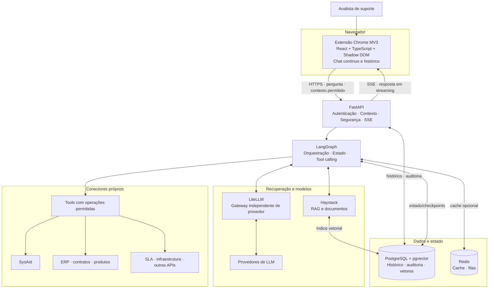

# Arquitetura alvo

Este documento descreve a arquitetura proposta para ajudar analistas a consultar clientes, contratos, serviços, infraestrutura, SLAs e histórico. Os blocos são o destino planejado; a demo atual ainda usa respostas mock e não implementa todos eles.

## Desenho

## Responsabilidade de cada bloco

| Bloco | Responsabilidade |
|---|---|
| Extensão Chrome | Apresentar o chat junto ao SysAid, permitir os modos SysAid e Geral e enviar apenas o contexto necessário. |
| FastAPI | Validar requisições, autenticar o analista, autorizar consultas, iniciar o fluxo e transmitir respostas por SSE. |
| LangGraph | Manter o estado da conversa e decidir quais etapas, recuperação ou ferramentas permitidas são necessárias. |
| LiteLLM | Fornecer uma interface uniforme para trocar de provedor/modelo sem acoplar os fluxos a um fornecedor. |
| Haystack | Ingerir documentos autorizados e recuperar trechos relevantes para responder com referências. |
| PostgreSQL + pgvector | Persistir conversas, auditoria e vetores usados pela busca semântica. |
| Redis | Cache e filas quando forem necessários; não é a fonte oficial do histórico. |
| Conectores | Encapsular operações documentadas do SysAid, ERP e demais sistemas. |

## Princípios do desenho

- Manter um monorepo com backend modular; separar serviços somente quando escala ou operação justificarem.
- Isolar prompts, workflows, tools e conectores.
- Usar componentes permissivos, sem depender de módulos Enterprise.
- Implantar no OpenShift/Kubernetes quando a fase de deploy for aprovada.
- Usar o domínio do e-mail apenas como pista para localizar uma empresa quando o campo estiver ausente; confirmar o resultado em fonte autorizada.

## Limites de confiança e segurança

- O backend é a autoridade para identidade, contexto e autorização. O ID enviado pelo navegador é apenas uma referência e precisa ser validado.
- A empresa e os dados do chamado devem vir de uma fonte autorizada consultada pelo backend; não confiar em valores declarados pela extensão.
- O domínio do e-mail pode ajudar a localizar a empresa quando ela estiver ausente, mas o resultado deve ser confirmado em fonte autorizada.
- Tools executam operações explícitas com parâmetros validados. O modelo nunca produz SQL arbitrário para execução.
- O histórico e a auditoria guardam apenas os dados necessários, com acesso limitado ao analista autorizado.
- Os conectores usam contratos configuráveis e documentação oficial; não presumem endpoints do SysAid ou ERP.

## Alvo versus demo atual

A demo de hackathon não representa a arquitetura completa:

| Desenho alvo | Demo atual |
|---|---|
| Extensão React + TypeScript + Shadow DOM | Side panel MV3 em HTML, CSS e JavaScript |
| Backend com autenticação e autorização | FastAPI local sem autenticação de negócio |
| LangGraph, LiteLLM e Haystack | Ainda não conectados |
| SysAid/ERP por conectores | A extensão captura apenas o ID do chamado; não consulta sistemas reais |
| PostgreSQL como histórico/auditoria e pgvector | PostgreSQL e Valkey sobem no Compose; liveness e readiness verificam processo e dependências. A resposta mock não consulta nem persiste dados neles |
| Redis | A infraestrutura local usa Valkey compatível com Redis; não participa do mock |
| Resposta real do assistente | Templates mock enviados em SSE |
| Histórico persistente no backend | O painel mantém históricos em memória durante a sessão e os envia junto à pergunta; não há persistência do chat |

Para instalar e executar o protótipo, consulte [Demonstração](demo.md).