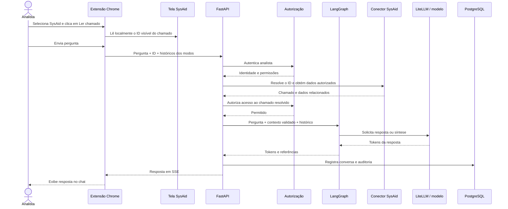
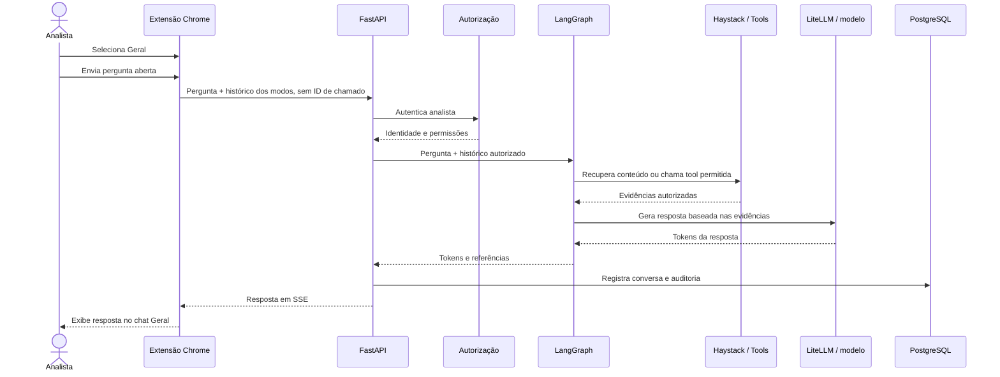
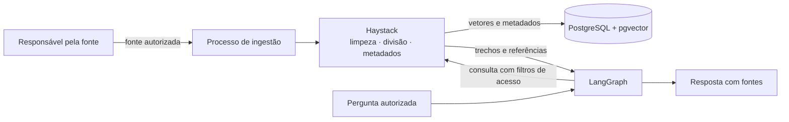

# Fluxos do assistente

Os fluxos abaixo descrevem o comportamento alvo. A seção final explica o que a demo faz hoje.

## 1. Pergunta sobre um chamado SysAid

**Proteção:** o backend não usa o ID como prova de autorização. Se o chamado não existir ou o analista não puder acessá-lo, a consulta é recusada e auditada.

## 2. Pergunta no modo Geral

O modo Geral não herda o ID do chamado. O histórico de Geral e o de SysAid são separados, mas enviados juntos para a API para preservar o contexto de cada conversa. A extensão limpa as duas conversas quando o analista inicia uma nova sessão pelo ícone da extensão.

## 3. Ingestão e consulta de documentos (RAG)

O processo de ingestão registra origem, versão e permissões de cada documento. Na consulta, filtros de acesso são aplicados antes de devolver trechos ao fluxo. O modelo recebe conteúdo recuperado, não acesso direto ao banco.

## 4. O que acontece na demo atual

1. O analista escolhe **SysAid** e autoriza o domínio no Chrome.
2. Ao clicar em **Ler chamado visível**, a extensão captura apenas o ID da URL `SREdit.jsp`.
3. A pergunta, o modo e os dois históricos seguem para o FastAPI local; somente no modo SysAid o ID é enviado.
4. O FastAPI responde com templates mock em SSE. Empresa e solicitante são nomes fictícios; não há consulta ao SysAid, ERP, LLM, Haystack ou banco.
5. No modo **Geral**, a extensão aceita perguntas sem ID e a API responde que o modelo ainda não está conectado.

Assim, os fluxos 1–3 são o desenho futuro; a demo comprova somente a interação visual, leitura explícita do ID, alternância de modos, histórico em memória e streaming mock.