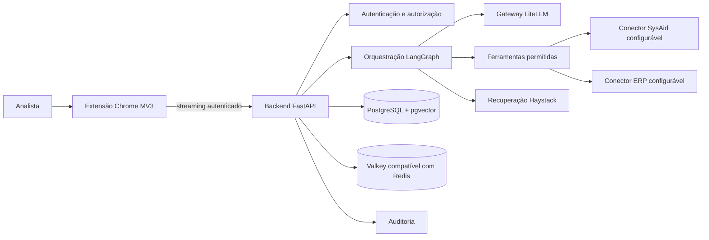

# Visão arquitetural

## Objetivo

Assistente conversacional para analistas consultarem informações autorizadas de clientes, contratos, serviços, infraestrutura, SLAs e histórico. A interface planejada é uma extensão Chrome integrada visualmente ao SysAid.

## Princípios

- Backend é autoridade para identidade, contexto e autorização; dados do navegador são não confiáveis.
- Não executar SQL arbitrário produzido por LLM. Tools futuras usarão operações explícitas, parâmetros validados e autorização por chamada.
- Não inferir endpoints SysAid/ERP. Conectores começam por interfaces/configuração e só implementam APIs documentadas.
- Manter um monorepo e backend modular até que escala ou limites operacionais justifiquem serviços separados.
- Isolar prompts, workflows, tools e conectores.
- Auditar consultas/respostas com minimização de dados sensíveis.
- Usar componentes permissivos e sem dependência de módulos Enterprise.

## Contexto de alto nível (alvo evolutivo)

O desenho não declara funcionalidades já implementadas. A Fase 1 oferece API mínima, PostgreSQL, cache local e health checks. O recorte de hackathon adiciona uma extensão demonstrativa e respostas mock, sem implementar os demais componentes do desenho.

## Fase 1 e demonstrador de hackathon

A API mantém pool de conexões PostgreSQL e cliente de cache no ciclo de vida do processo. Liveness mede se o processo responde; readiness verifica `SELECT 1` e `PING`.

No recorte demo, o side panel injeta uma função somente após ação explícita do analista (`activeTab`) e lê um conjunto pequeno de campos visíveis/rotulados da aba. O FastAPI valida o formato permitido e transmite uma resposta estática mock em SSE. Não há chamada a SysAid, ERP, LLM ou banco para compor essa resposta, nem decisão de autorização de negócio.

## Identificação de chamado e cliente (fases futuras)

O identificador do chamado fornecido pela extensão deve ser resolvido pelo backend junto ao SysAid. Domínio de e-mail é uma pista de resolução quando a empresa estiver ausente; o resultado precisa ser confirmado por fonte autorizada. Nunca aceitar identificador de cliente como prova de autorização.

## Implantação (fases futuras)

Compose é somente para desenvolvimento local. Imagens, configuração, segredos, probes e políticas de rede do OpenShift serão definidos na Fase 9 com base no cluster alvo.
